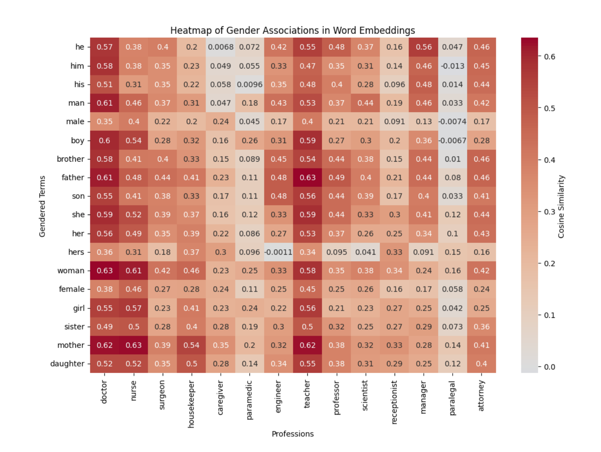
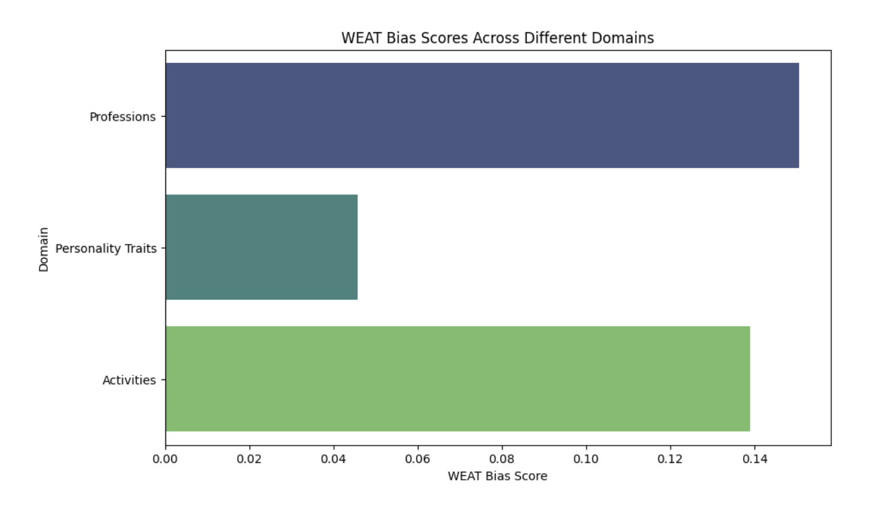
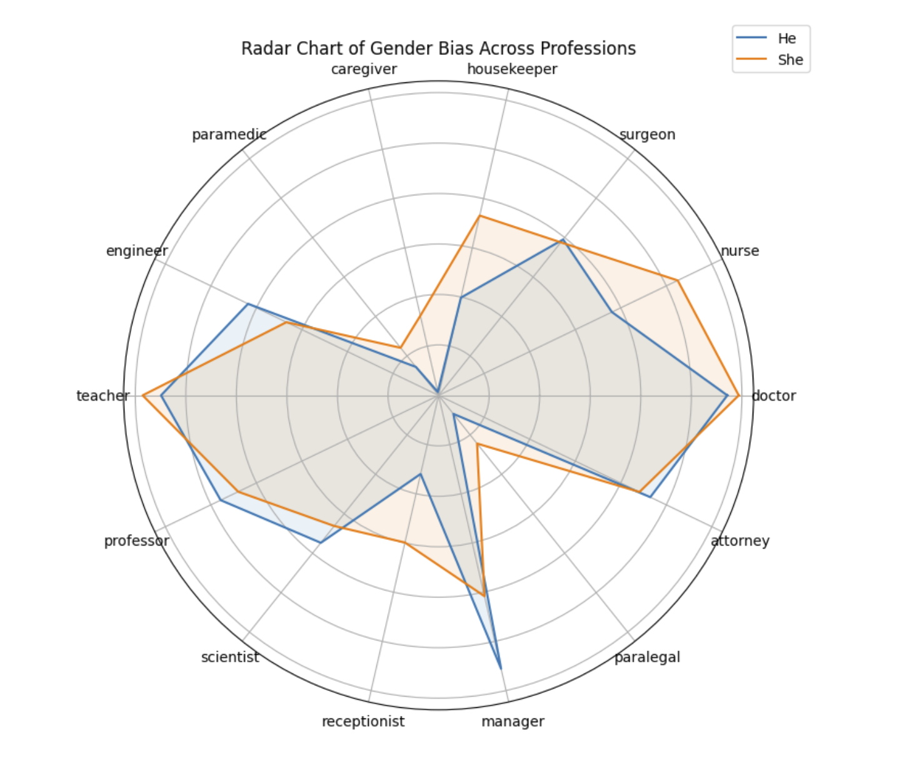
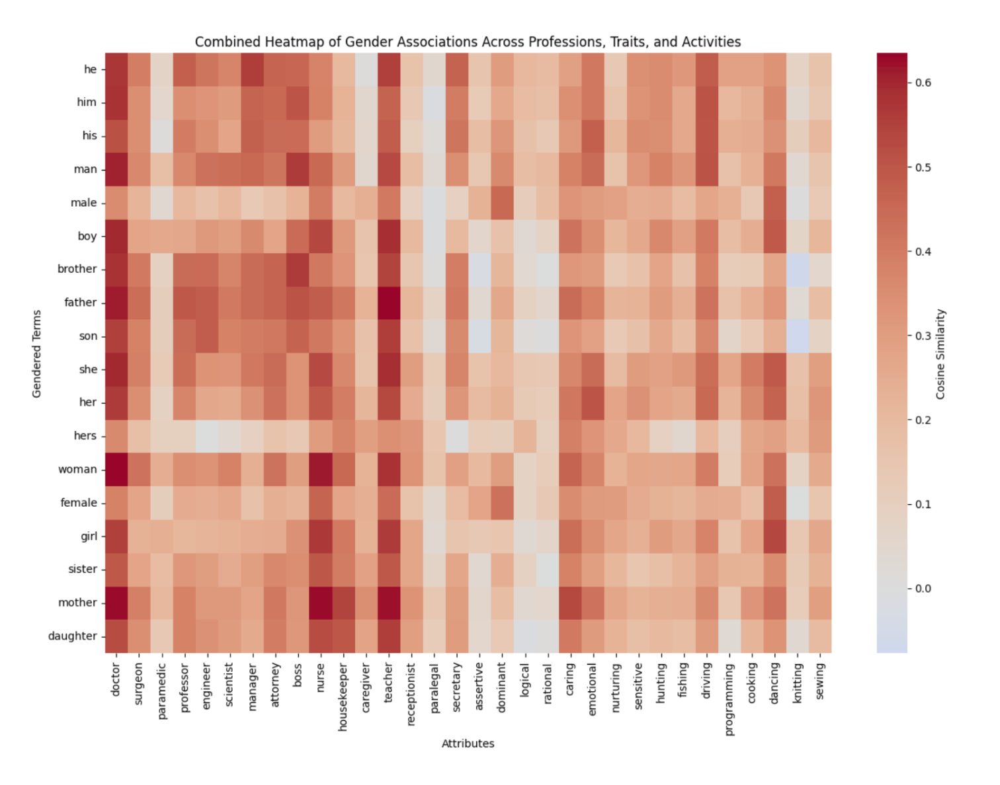
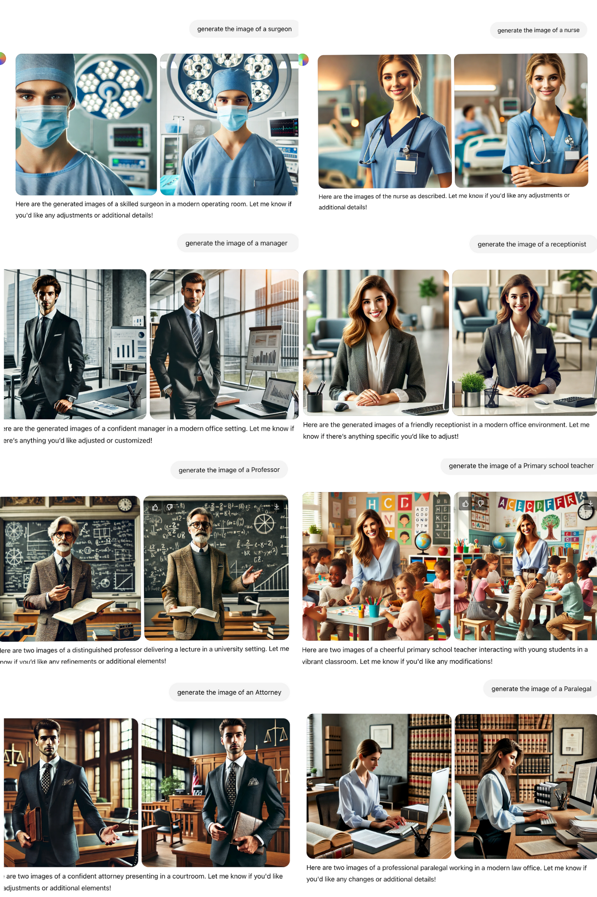
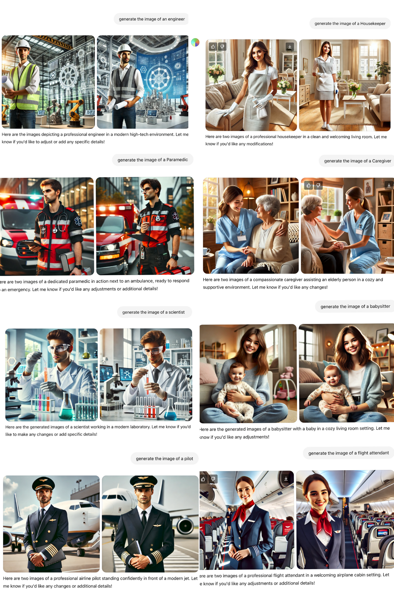

# Unveiling Bias
### Visualizing Gender Bias in Word Embeddings

**Selin Deniz İşken · University of Manchester · UCIL20421 Visualising Information · Individual coursework, 2024**

An exploratory responsible AI project combining Python analysis of pretrained word embeddings, statistical visualisation, and a qualitative comparison of AI-generated profession images.

**Python · GloVe 100d · Cosine similarity · WEAT-inspired associations · Visual storytelling · Responsible AI**



*Original submitted figure. The recovered notebook covers eight professions; this later 14-profession asset is preserved without claiming complete source reproducibility.*

## Why investigate these associations?

Language models learn from records of human language, including social stereotypes. This project asks how visualisation can make gendered associations visible and communicate their limitations responsibly.

- How do selected male and female terms associate with profession words in pretrained GloVe vectors?
- How does a chosen association contrast vary across professions, personality traits, and activities?
- What gender presentations appear in preserved outputs from gender-unspecified profession prompts?

The aim is to examine patterns in these selected representations. The analysis does not establish the gender of real people, prove discrimination in a deployed system, or show that GloVe causes image-generation behavior.

## At a glance

| Component | Evidence and scope |
|---|---|
| Embeddings | Stanford GloVe 6B, 100 dimensions; pretrained, not trained for this project |
| Recovered code | Nine male terms, nine female terms, eight professions, eight traits, eight activities |
| Original figures | Profession heatmap, combined heatmap, domain comparison, and radar chart |
| Later figure scope | Profession heatmap and radar chart contain 14 professions; expanded code is missing |
| Image comparison | Preserved prompt/output collages; qualitative observations only |
| Historical submission | [Submitted essay — public metadata copy](reports/unveiling-bias-submitted-essay.pdf) |

## From embeddings to visual evidence

### Cosine similarity

Each word is represented by a 100-dimensional vector. Cosine similarity compares vector directions:

$$\operatorname{cos}(u,v)=\frac{u\cdot v}{\lVert u\rVert\lVert v\rVert}.$$

The heatmaps display similarities for individual gender–attribute pairs. Higher similarity means greater proximity in this embedding space; it is not a probability or a direct measure of social harm. Comparisons between gender terms are more informative than treating a large cell value alone as evidence of bias.

### WEAT-inspired association difference

For a word $w$ and selected attribute sets $A,B$, define:

$$s(w,A,B)=\operatorname{mean}_{a\in A}\operatorname{cos}(w,a)-\operatorname{mean}_{b\in B}\operatorname{cos}(w,b).$$

The recovered function returns:

$$D=\operatorname{mean}_{x\in X}s(x,A,B)-\operatorname{mean}_{y\in Y}s(y,A,B),$$

where $X$ and $Y$ are the male and female word lists. Positive $D$ means the selected male words show a stronger A-versus-B contrast than the selected female words.

This is an **unstandardized difference in mean associations inspired by WEAT**, not a formal WEAT effect size or inferential test. The notebook performs no permutation test and reports no p-values, confidence intervals, or statistical significance. The historical function name `weat_score` and original figure labels are retained for provenance.

| Domain | Attribute set A | Attribute set B |
|---|---|---|
| Professions | doctor, engineer, scientist, manager | nurse, teacher, receptionist, clerk |
| Traits | assertive, dominant, logical, rational | caring, emotional, nurturing, sensitive |
| Activities | hunting, fishing, driving, programming | cooking, dancing, knitting, sewing |

These groupings are researcher-selected operational choices, not claims that a role or trait belongs to a gender. Cross-domain score rankings are conditional on these lists and are not universal rankings of bias.

## Findings, with the evidence kept separate

| Domain | Essay narrative: reported approximately | Recovered calculation: independently checked |
|---|---:|---:|
| Professions | 0.14 | 0.15055 |
| Personality traits | 0.08 | 0.04577 |
| Activities | 0.12 | 0.13903 |

Both records are preserved. The recovered calculations agree with the original domain chart below; the essay's approximate numbers differ beyond simple rounding. The reason for the discrepancy is not established. See [verification notes](docs/VERIFICATION.md) and the [score table](results/score-comparison.csv).

For these selected lists, the recovered contrast is positive in all three domains, largest for professions and smallest for traits. This is descriptive evidence of an association pattern in these embeddings, not a claim of statistical significance.

| Domain contrast | Profession comparison |
|:---:|:---:|
|  |  |

*The left image retains its original “WEAT Bias Score” label; interpret it using the unstandardized definition above. The radar compares individual “he” and “she” similarities, rather than the nine-word group contrast. Its hidden radial labels make it a visual overview rather than a precise reading tool.*

The original heatmap and radar show stronger “she” associations for examples such as nurse and housekeeper, and stronger “he” associations for engineer and manager. Patterns are not uniform: “she” is also slightly closer to doctor in the displayed heatmap. This nuance matters when interpreting stereotype narratives.

<details>
<summary><strong>Explore the original combined heatmap</strong></summary>



The combined view supports comparison across multiple attributes in one grid. Color encodes cosine similarity; it does not encode significance or causality. The preserved figures are screenshot assets, not newly generated replacements.

</details>

## Gender-unspecified prompts, gendered visual outputs

The essay identifies the image-generation tool as **DALL·E**. Preserved screenshots show prompts such as “generate the image of a surgeon” and “generate the image of a nurse,” alongside generated outputs. The exact model version, full conversation history, rewritten backend prompts, and generation settings were not recovered.

| Professions and support roles | Technical, care, and transport roles |
|:---:|:---:|
| [](assets/images/visualgenderbias1.png) | [](assets/images/visualgenderbias2.png) |

*Open either collage to inspect its original prompts and details.*

The displayed examples present managers and engineers as masculine, while nurses and caregivers are presented as feminine. These are qualitative observations about apparent presentation in retained images, not determinations of anyone's gender identity. The screenshots document selected outputs; they do not reveal generation frequencies, selection criteria, independence between outputs, or a representative sampling procedure.

The text and image examples offer complementary perspectives on stereotypes. Their similarity does not establish a shared training mechanism, dataset, or causal relationship.

## Reproduce the recovered notebook

Use **Python 3.10 or 3.11**. The requirements pin a compatibility environment around the recovered scientific stack; a complete end-to-end environment run remains a review item. Numerical checks are described separately below.

```bash
cd visualising-gender-bias-in-ai
python3 -m venv .venv
source .venv/bin/activate
python -m pip install -r requirements.txt
```

Download **`glove.6B.zip`** from the [Stanford GloVe project](https://nlp.stanford.edu/projects/glove/), then extract only `glove.6B.100d.txt` into `data/`. Use the original 6B release, not the newer 2024 vectors or a Common Crawl release. The 862 MB archive and extracted vectors are intentionally excluded from this package.

```bash
unzip /path/to/glove.6B.zip glove.6B.100d.txt -d data/
jupyter lab notebooks/weatvisual.ipynb
```

[Open the cleaned notebook](notebooks/weatvisual.ipynb).

Select the environment's Python kernel, restart it, and run cells in order. Loading all 400,000 vectors requires several hundred MB of memory plus notebook overhead. The notebook accepts the package root or `notebooks/` as its working directory.

The early same-set A/B example intentionally yields zero. The later distinct-set cell produces the values in the table above. All original calculations remain; installation commands, execution outputs, and machine-specific scaffolding were cleaned. An unused `mplsoccer` dependency was removed and the network colorbar was given an explicit axes target. See [provenance](docs/PROVENANCE.md).

Running the notebook reproduces the recovered eight-profession analysis. It will not reproduce the expanded fourteen-profession heatmap or radar exactly. The exploratory network layout is unseeded and may vary; package versions may also affect plot appearance.

## Ethical implications and limitations

- **Representation:** the inherited binary gender word lists exclude nonbinary identities and combine pronouns with kinship terms. Their results should not be generalized to all gendered language.
- **Measurement:** static word vectors ignore context. Chosen words and A/B partitions strongly shape the scores; higher cosine similarity alone does not establish unfair treatment.
- **Uncertainty:** no inferential statistics were computed. PCA, clustering, and the network are exploratory visualisations rather than independent tests of bias.
- **Image evidence:** a small, selected visual record cannot establish model-wide rates or changes over time. Appearance-based interpretation can itself reproduce stereotypes.
- **Scope:** this project examines historical pretrained representations and retained image outputs. It does not evaluate a contemporary deployed model, validate mitigation, or establish downstream harms.

Making these boundaries visible is part of the responsible AI contribution: a compelling chart should communicate what its evidence supports, including where that evidence ends.

## Provenance and credits

This is an individual coursework project by Selin Deniz İşken. The project contribution is the investigation, adaptation and application of association analysis, visual presentation, and critical interpretation; it does not include training GloVe or inventing WEAT. The recovery record does not establish sole authorship of every notebook line. Assistant-style planning material suggests assisted planning; its exact tool and extent were not verified.

- **GloVe:** Jeffrey Pennington, Richard Socher, and Christopher D. Manning (2014), [GloVe: Global Vectors for Word Representation](https://nlp.stanford.edu/projects/glove/). The 6B release uses Wikipedia 2014 and Gigaword 5. Stanford lists pretrained vectors under the Public Domain Dedication and License v1.0; vectors are not bundled here.
- **WEAT:** Aylin Caliskan, Joanna J. Bryson, and Arvind Narayanan (2017), [Semantics derived automatically from language corpora contain human-like biases](https://doi.org/10.1126/science.aal4230), with [author preprint](https://arxiv.org/abs/1608.07187). This project uses an inspired descriptive contrast, not a full replication.
- **Notebook scaffolding:** the recovered notebook contained standard [Kaggle Python environment](https://github.com/Kaggle/docker-python) boilerplate. Irrelevant environment instructions were removed, and attribution retained. Gensim, NumPy, pandas, Matplotlib, seaborn, SciPy, scikit-learn, and NetworkX provide the analysis tools.
- **Generated images:** OpenAI DALL·E, as identified in the original essay; preserved through ChatGPT-style prompt/output screenshots. No exact model version is asserted. Generated images are not hand-created illustrations by the project author.
- **Portfolio preparation:** recovery documentation, explanatory markdown, dependency setup, and non-methodological notebook cleanup were prepared with Codex assistance. Original figure pixels and essay page content are preserved. Public copies remove identifying metadata; the essay also has a neutral filename. See the provenance record.

The essay is a historical submission, not a corrected technical report. Its score discrepancies, broader factual claims, and bibliography require separate scrutiny before reuse. See [publication review](docs/PUBLICATION_REVIEW.md) for completed privacy and coursework checks and [third-party notices](docs/THIRD_PARTY_NOTICES.md) for attribution scope. No repository-wide licence is assigned; this does not claim new reuse rights over third-party material.

## Package map

```text
assets/charts/       Four original submitted charts
assets/images/       Two original profession prompt/output collages
notebooks/           Cleaned recovered eight-profession notebook
reports/             Submitted essay with public-safe metadata
results/             Reported-versus-recovered score comparison
data/                Download instructions; no embedding files
docs/                Provenance, verification, publication review, asset hashes
requirements.txt     Proposed compatible Python environment
```
